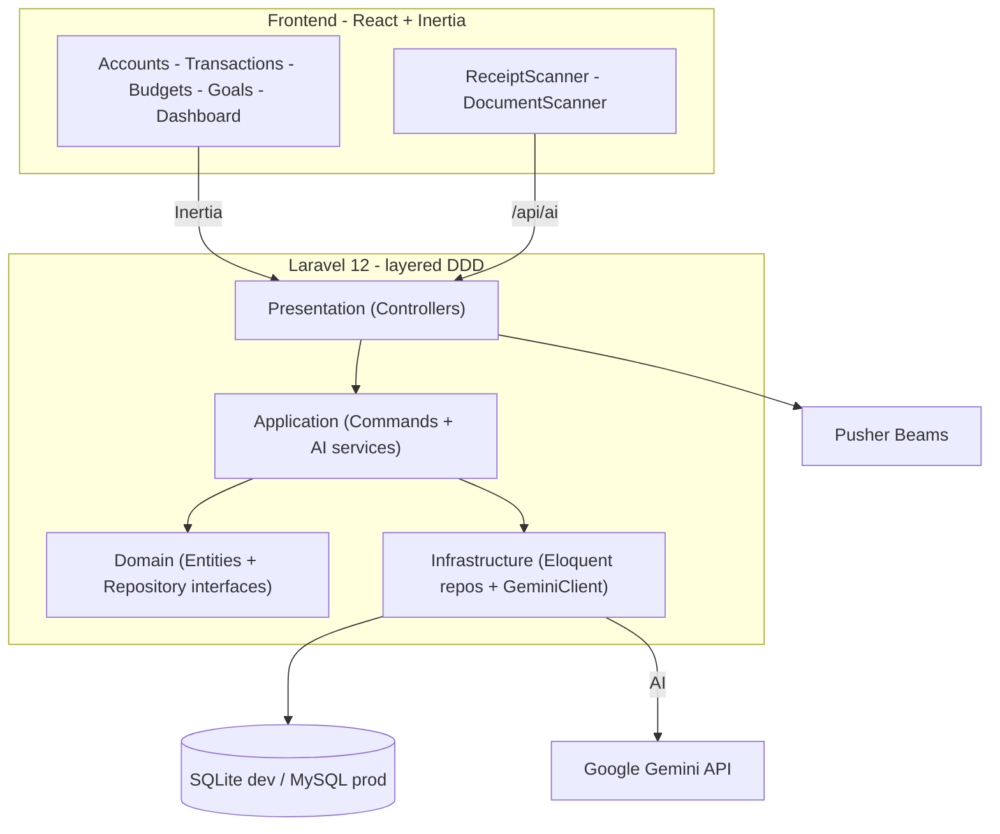

# CashPilot

> An **AI-powered personal-finance management app** — track accounts, transactions, budgets, and goals, with Google Gemini features like receipt OCR, natural-language transaction entry, and financial insights.

CashPilot (internally also called **FinGenie**) helps you manage multiple financial accounts, record income/expense/transfer transactions, organize them with categories and tags, set budgets, and track progress toward savings goals — all on a clean dashboard with reports and charts. On top of standard finance tooling, it layers a rich set of **Gemini AI** capabilities: scan receipts, parse accounts documents, enter transactions in plain English, get budget recommendations and anomaly alerts, and chat with a finance assistant. Defaults are localized for **Bangladesh** (BDT currency, `Asia/Dhaka` timezone, local banks & mobile-banking providers).

> ℹ️ The repository is named **CashPilot** while the code and docs use **FinGenie** — they refer to the same app.

---

## ✨ Features

### 💰 Core finance
- **Accounts** — manage multiple accounts (cash, bank, credit/debit card, mobile banking, savings, investment) with balances, status, and account-number visibility toggle; **transfer funds between accounts**.
- **Transactions** — income, expense, and transfer entries with categories, tags, notes, receipts, and recurring support.
- **Categories & tags** — hierarchical income/expense categories (global or user-owned) and custom tags.
- **Budgets** — monthly/yearly budgets with per-category allocations and spent tracking.
- **Financial goals** — target amount, target date, and saved-amount progress.
- **Dashboard** — income / expense / net balance / savings-rate tiles, recent transactions, budgets, and goals.
- **Reports** — spending and income analysis with charts (Recharts).
- **Settings** — profile, preferences (theme/language/notifications), and financial defaults (currency, date format, timezone).

### 🤖 AI (Google Gemini)
- **Receipt OCR** — scan a receipt to auto-create a transaction.
- **Account-document OCR** — extract account details from documents.
- **Natural-language transaction entry** — "spent 500 on groceries yesterday" → a structured transaction.
- **Category suggestion** & **description enhancement**.
- **Financial insights** — summaries, budget recommendations.
- **Anomaly detection** — flag unusual transactions.
- **Finance chat assistant**.

### 📱 Platform
- **Progressive Web App** (installable)
- **Push notifications** via Pusher Beams

---

## 🧰 Tech stack

**Backend**
- [Laravel 12](https://laravel.com) (PHP ^8.2)
- **Inertia.js** (`inertiajs/inertia-laravel`) + Ziggy
- Laravel Sanctum (API auth) & Breeze (auth scaffolding)
- `ladumor/laravel-pwa` (PWA), Pusher Beams push notifications
- **Google Gemini** via a custom `GeminiClient` (default model `gemini-2.0-flash`)

**Frontend**
- **React 18** + TypeScript via **@inertiajs/react**
- **Vite** + Tailwind CSS 3 + **shadcn/ui**-style components, lucide-react icons
- **Recharts** for charts

**Database:** SQLite for local dev, MySQL in production (Eloquent ORM).

---

## 🏗️ Architecture

### System design



A single Laravel + Inertia app with a deliberate **layered / Domain-Driven Design** structure:

```
app/
├── Domain/           # Entities (Eloquent models) + Repository interfaces + AI service interfaces
├── Application/       # Use-case layer: command objects + AI service implementations
├── Infrastructure/   # Eloquent repository implementations + GeminiClient (AI)
├── Presentation/      # HTTP controllers grouped by feature (Account, Transaction, Budget, Goal, AI/*, …)
└── Http/              # Framework pieces: Breeze auth, Inertia middleware, form requests

resources/js/
├── Pages/             # Inertia page components (.tsx)
├── Layouts/           # Authenticated / Guest layouts
├── Components/         # ReceiptScanner, AccountDocumentScanner, TransferForm, …
└── components/ui/      # shadcn primitives
```

---

## 🗄️ Data model (selected)

| Table | Purpose |
|---|---|
| `accounts` | Financial accounts (type, balance, bank/mobile-banking refs, status) |
| `transactions` | Income/expense/transfer (amount, category, receipt, recurring) |
| `categories` | Hierarchical income/expense categories (global or user) |
| `tags` + `transaction_tags` | Custom tags |
| `budgets` + `budget_categories` | Budgets with per-category allocations & spent amounts |
| `financial_goals` | Savings goals (target/current amount, target date) |
| `financial_institutions` | Bangladeshi banks & mobile-banking services |
| `user_profiles` | Personal, financial, and app-preference settings |

All monetary amounts are `decimal(15,2)`, default currency `BDT`.

---

## 🚀 Getting started

### Prerequisites
- PHP 8.2+ and Composer
- Node.js 20+ and npm
- A **Google Gemini API key** (for AI features)

### Quick setup

```bash
composer run setup
```

This runs `composer install`, copies `.env`, generates the app key, migrates the database, installs npm packages, and builds assets.

### Manual setup

```bash
composer install
cp .env.example .env
php artisan key:generate
php artisan migrate
php artisan db:seed            # seeds Bangladeshi financial institutions
npm install
npm run dev
```

### Run (dev)

```bash
composer run dev
```

Runs the PHP server, queue listener, log viewer (Pail), and Vite concurrently.

### Environment variables

Configure in `.env` (names only — supply your own values):

- **App:** `APP_NAME` (FinGenie), `APP_ENV`, `APP_KEY`, `APP_DEBUG`, `APP_URL`, `APP_LOCALE`
- **Database:** `DB_CONNECTION` (sqlite by default; MySQL `DB_*` for production)
- **Gemini AI:** `GEMINI_API_KEY`, `GEMINI_MODEL`, `GEMINI_VISION_MODEL`, `GEMINI_TEMPERATURE`, `GEMINI_MAX_TOKENS`, `GEMINI_TIMEOUT`, `GEMINI_CACHE_ENABLED`, `GEMINI_CACHE_TTL`
- **Push notifications:** `PUSHER_BEAMS_INSTANCE_ID`, `PUSHER_BEAMS_SECRET_KEY` *(required for push; add these to your `.env`)*
- **Mail / AWS / cache / queue:** `MAIL_*`, `AWS_*`, `CACHE_STORE`, `QUEUE_CONNECTION`, `SESSION_DRIVER`

> ✅ The committed `.env.example` contains only empty placeholders — no real secrets. Keep your real keys in the git-ignored `.env`.

---

## 📡 AI API

AI endpoints live under `/api/ai/*` (session + Sanctum auth):

| Method | Endpoint | Description |
|---|---|---|
| `POST` | `/api/ai/receipt-ocr` | Extract a transaction from a receipt image |
| `POST` | `/api/ai/account-document-ocr` | Extract account details from a document |
| `POST` | `/api/ai/suggest-category` | Suggest a category for a transaction |
| `POST` | `/api/ai/natural-language` | Parse plain-English into a transaction |
| `GET` | `/api/ai/insights` · `/insights/budget-recommendations` · `/insights/summary` | Financial insights |
| `POST` | `/api/ai/chat` | Finance chat assistant |
| `POST` | `/api/ai/enhance-description` | Improve a transaction description |
| `GET`/`POST` | `/api/ai/anomalies` · `/anomalies/check` | Anomaly detection |

Full AI setup is documented in [`AI_SERVICES_SETUP.md`](AI_SERVICES_SETUP.md).

---

## 🚢 Deployment

Deploys to **cPanel** via GitHub Actions (`.github/workflows/deploy-cpanel.yml`) and/or the `deploy.sh` script. See [`DEPLOYMENT.md`](DEPLOYMENT.md) for the full cPanel + MySQL guide.

---

## 🧪 Testing

```bash
composer run test
```

---

## 📄 License

MIT.
